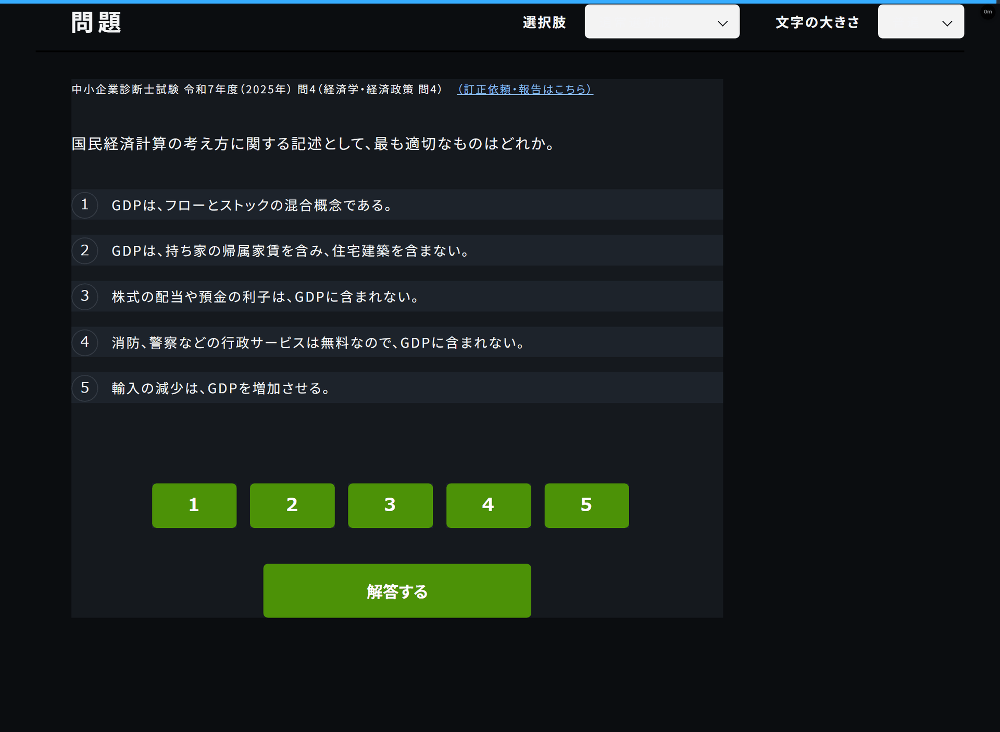

# kakomonn

Unofficial reading, keyboard and spaced-repetition tools for [kakomonn.com](https://kakomonn.com/). Not affiliated with the site's operator.

[Install Reader](kakomonn-reader/README.md#installation) / [Learning log](https://kakomonn-sync.kakomonn.workers.dev/) / [Usage and development](docs/guide.md)

## Get started

Use Windows 11 Chrome with Tampermonkey Beta, or iPhone Safari with Tampermonkey. Install Reader and enter your sync token when prompted. Speech requires an internet connection.

Open the [next question](https://kakomonn-sync.kakomonn.workers.dev/open), or use the [Windows launcher](docs/guide.md#windows-setup).

### PC keyboard shortcuts

| Key | Action |
| --- | --- |
| `q`, `w`, `e`, `r`, `t` | Select answer 1 through 5. |
| `Enter` | Submit the answer. After an incorrect answer, advance to the next question. |
| `a`, `s`, `d`, `f`, `g` | Toggle strikethrough on choice 1 through 5. |
| `Space` | Pause or resume speech. |
| `n` | Skip the current question, recording it as incorrect. |
| `z` / `x` | Scroll down / up. |
| `gg` | Return to the top of the question. |
| `Shift+H` | Go back to the learning log. |

Shortcuts are disabled while typing in text fields. After an incorrect answer, browser Forward also advances to the next question.

### iPhone controls

- Tap an answer choice, then tap the site's answer button to submit.
- If speech does not start, tap the page to allow audio playback.
- After an incorrect answer, swipe left from the middle of the screen to continue. Avoid starting at the edge, where Safari handles navigation gestures.
- Use Safari Back to return to the learning log and Forward to resume the latest question.

On both devices, correct answers advance automatically. Answering also copies the question and explanation as Markdown to the clipboard. If syncing fails, use the retry action in the error dialog before continuing.

## Components

| Component | Purpose |
| --- | --- |
| [Reader](kakomonn-reader/README.md) | Read aloud, answer by keyboard and copy Markdown. |
| [Sync](kakomonn-sync/README.md) | Schedule questions with FSRS and share learning records across devices. |

[Tests](docs/guide.md#tests) / [Release and deployment](docs/guide.md#release-and-deployment) / [MIT license](LICENSE)
